<!--
BORRADOR. Mismo formato del blog del Trabajo 1 (blog_trabajo1.Rmd).
Las marcas [PENDIENTE] señalan lo que falta; se pueden buscar con: grep -n "PENDIENTE" blog/blog_trabajo2.Rmd
Fuentes de contenido: reporte/blog_post_tecnico_(Borrador).md, docs/parte2_lgd.md,
docs/fundamentacion_matematica.md y las salidas de los notebooks. Ninguno de esos archivos se modificó.
Todos los números salen de las salidas guardadas en los notebooks o de los scripts de scripts/; la fuente se indica en cada tabla y figura.
-->

**Trabajo 2 · Redes neuronales y algoritmos bioinspirados · Universidad Nacional de Colombia, Facultad de Minas · 2026-02**

**Equipo:** Tomás Gómez Cardona, Sebastián Ocampo Galvis, Juan Felipe Miranda Arciniegas y Juan José Baena García. **[PENDIENTE: confirmar integrantes y la parte de cada uno.]**

**Entrada publicada en RPubs:** **[PENDIENTE]**
**Repositorio:** https://github.com/tomasgodev/RedesNeuronales_Trabajo2
**Aplicación web:** **[PENDIENTE]**
**Video promocional:** **[PENDIENTE]**
**Videos de contribución individual:** **[PENDIENTE]**

---

## Resumen

Estimamos con perceptrones multicapa dos cantidades de créditos de consumo de Lending Club: la probabilidad de incumplimiento (PD) y la pérdida dado incumplimiento (LGD). Los comparamos con una regresión logística y una regresión lineal, con las mismas variables, la misma partición temporal y un presupuesto de búsqueda explícito.

Con 193,050 créditos originados entre 2012 y 2015, la red final de PD alcanza un AUC de 0.703 en prueba (media de 30 semillas), igual al de la regresión logística (0.703); la mejor configuración de una búsqueda de 31 llega a 0.704. Después de corregir el efecto del peso de clase, ambos modelos quedan bien calibrados. En LGD, la red tiene menor RMSE que la regresión lineal (0.081 frente a 0.093), pero esa ventaja viene de acertar el nivel de una LGD inflada por el recobro incompleto: la regresión lineal ordena mejor a los clientes.

Convertimos la PD en una scorecard (puntaje base 600, odds 50:1, PDO 20) que ordena el riesgo: el incumplimiento va de 50 % en el decil de menor puntaje a 5.7 % en el de mayor puntaje. Explicamos cuántos puntos aporta cada variable y estimamos una pérdida esperada de 18.7 % del monto en el periodo de prueba. Cada experimento se reproduce con un solo comando, y la aplicación web permite a cualquier persona calcular su puntaje y ver cómo cambiaría.

---

## 1. Caso de uso

**Quién lo usa.** El área de riesgo de crédito de un prestamista que financia créditos de consumo originados en la plataforma Lending Club.

**Para qué decisión.** Decidir si se financia un crédito y estimar su pérdida esperada, $E[L] = PD \cdot LGD \cdot EAD$, para provisionarlo. La probabilidad de incumplimiento ($PD$) también se expresa como un puntaje de scorecard para que el analista y el solicitante la puedan leer.

**En qué momento.** Después de que la plataforma califica la solicitud y fija sus condiciones, y antes del desembolso. El diccionario de variables define `sub_grade` como *"LC assigned loan subgrade"*, y `int_rate` como *"Interest Rate on the loan"*. Como ambas son entradas del modelo, el modelo solo se puede aplicar cuando ya existen; no sirve en el instante en que la persona empieza a llenar el formulario.

**Con qué información.** Solo con lo que se conoce en ese momento (Tabla 1).

**Tabla 1.** *Información disponible al decidir y variables que usa el modelo.*

| Grupo | Variables |
|---|---|
| Solicitud | `loan_amnt`, `term`, `purpose` |
| Solicitante | `annual_inc`, `home_ownership`, `verification_status`, `addr_state`, `dti` |
| Historial de crédito | `delinq_2yrs`, `inq_last_6mths`, `open_acc`, `revol_bal`, `revol_util`, `total_acc`, `collections_12_mths_ex_med`, `acc_now_delinq`, `tot_cur_bal` |
| Condiciones asignadas por la plataforma | `sub_grade`, `int_rate` |

*Fuente:* elaboración propia a partir de `src/preprocesamiento.py` y de `datasets/LCDataDictionary.xlsx`.

**Lo que no se puede usar.** Todo lo que se observa después del desembolso: pagos, saldos, recuperaciones y fechas de pago (`out_prncp`, `total_pymnt`, `total_rec_prncp`, `total_rec_int`, `total_rec_late_fee`, `recoveries`, `collection_recovery_fee`, `last_pymnt_amnt`, `last_pymnt_d`, `next_pymnt_d`, `last_credit_pull_d`, entre otras). Por ejemplo, el diccionario define `recoveries` como *"post charge off gross recovery"*: solo existe si el crédito ya se castigó. Estas columnas se usan únicamente para construir las variables objetivo de la Parte 2, nunca como entradas.

**Qué implica para el modelamiento.**

1. La partición de datos es temporal, por `issue_d` (*"The month which the loan was funded"*), porque el modelo se aplicará a créditos futuros.
2. La exposición al incumplimiento se estima al originar, porque en ese momento no se sabe cuánto habrá pagado el cliente cuando incumpla (Sección 4.9).
3. La aplicación web pide exactamente las mismas variables que usa el modelo.

**Limitación.** El diccionario no dice en qué fecha se midieron las variables de historial de crédito; por ejemplo, `tot_cur_bal` es *"Total current balance of all accounts"*. Suponemos que corresponden a la fecha de la solicitud. **[PENDIENTE: buscar si hay una fuente que lo confirme.]**

---

## 2. Datos

### 2.1 Fuente

Usamos el conjunto *Credit Risk Analysis* de Kaggle (ranadeep, s. f.), versión 3, archivo `loan/loan.csv`: **887,379 registros y 74 variables**, de créditos originados entre **junio de 2007 y diciembre de 2015** (`issue_d`). Fecha de la descarga original del equipo: **[PENDIENTE]**. Para verificar la reproducibilidad lo descargamos de nuevo el 27 de octubre de 2026 (versión 3). Con esa descarga, `python -m src.preprocesamiento` produce un archivo idéntico a `datasets/creditos_procesados.csv.gz`. Los significados de las variables se citan del diccionario incluido en el conjunto (`datasets/LCDataDictionary.xlsx`).

Un detalle del diccionario: no trae la variable `verification_status`, pero sí `is_inc_v`, *"Indicates if income was verified by LC, not verified, or if the income source was verified"*. Sus tres valores coinciden con los de `verification_status` en el archivo (`Not Verified`, `Source Verified`, `Verified`), así que tomamos esa definición.

### 2.2 Variable objetivo de la Parte 1

Codificamos `loan_status` como lo indica el enunciado (Tabla 2). De los 887,379 créditos, **268,530** tienen un estado codificado como 0 o 1; los demás (NA) se excluyen. De ellos, **58,819** son incumplimientos.

**Tabla 2.** *Codificación de `loan_status`.*

| Categoría original | Codificación | Créditos |
|---|---|---|
| Fully Paid | 0 | 207,723 |
| Does not meet the credit policy. Status:Fully Paid | 0 | 1,988 |
| Charged Off | 1 | 45,248 |
| Default | 1 | 1,219 |
| Late (31-120 days) | 1 | 11,591 |
| Does not meet the credit policy. Status:Charged Off | 1 | 761 |
| Current | NA (excluido) | 601,779 |
| Issued | NA (excluido) | 8,460 |
| In Grace Period | NA (excluido) | 6,253 |
| Late (16-30 days) | NA (excluido) | 2,357 |

*Fuente:* codificación del enunciado; conteos de `python scripts/parte1_descriptivo.py` (`resultados/parte1/descriptivo_loan_status.csv`).

El 68 % de los créditos del archivo está en estado `Current` y queda fuera del entrenamiento. La Sección 3.1 muestra que esa exclusión no es pareja en el tiempo.

### 2.3 Limpieza y selección de variables

El procesamiento está en `notebooks/procesamiento.ipynb` y la versión que usan todos los modelos, en `src/preprocesamiento.py`. Se regenera con:

```bash
python -m src.preprocesamiento
```

1. **Columnas excluidas.** Identificadores (`id`, `member_id`, `policy_code`), texto libre o de alta cardinalidad (`url`, `emp_title`, `desc`, `title`, `zip_code`, `earliest_cr_line`) y las variables posteriores al desembolso de la Sección 1.
2. **Nulos.** Se eliminan 20 columnas con muchos nulos: las de solicitudes conjuntas, que están vacías en más del 99.9 % de los créditos, y otras como `mths_since_last_delinq`, con 55 %. Después se eliminan las filas con nulos en `total_rev_hi_lim`, `tot_cur_bal`, `tot_coll_amt`, `emp_length`, `revol_util` y `collections_12_mths_ex_med`. Las tres primeras no existen para las cosechas anteriores a agosto de 2012, por eso los datos procesados empiezan en 2012-08.
3. **Variables numéricas sin relación con el incumplimiento.** Con una prueba ANOVA se descartan `pub_rec` ($F = 0.005$, $p = 0.94$) y `tot_coll_amt` ($F = 0.33$, $p = 0.57$). El resto tiene $p < 0.001$.
4. **Variables numéricas redundantes.** `loan_amnt` tiene correlación de 1.00 con `funded_amnt` y `funded_amnt_inv`, y de 0.96 con `installment`; `revol_bal` tiene 0.83 con `total_rev_hi_lim`. Se conservan `loan_amnt` y `revol_bal` (Figura 1).
5. **Variables categóricas.** Con la V de Cramér frente al incumplimiento se descartan `emp_length` (0.03), `pymnt_plan`, `initial_list_status` y `application_type` (0.00 las tres). Se conservan `sub_grade` (0.26), `term` (0.16), `verification_status` (0.08), `home_ownership` (0.07), `purpose` (0.06) y `addr_state` (0.06). `grade` se descarta porque su V con `sub_grade` es 1.00 (Figura 2).
6. **Codificación.** `sub_grade` queda ordinal (A1 = 0, …, G5 = 34) y `verification_status` también (0 a 2). `term`, `home_ownership`, `purpose` y `addr_state` pasan a variables indicadoras, eliminando una categoría de cada una.

El resultado son **193,050 créditos y 82 variables de entrada**, originados entre agosto de 2012 y diciembre de 2015, con una tasa de incumplimiento de **23.3 %**.

**Figura 1.** *Correlación de Pearson entre las variables numéricas.*

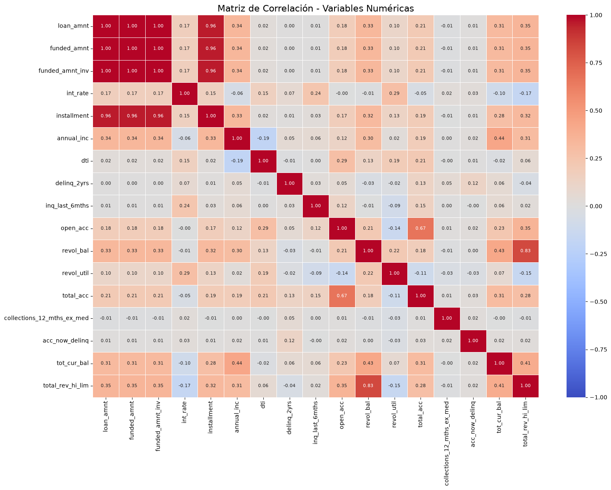

*Fuente:* elaboración propia, `notebooks/procesamiento.ipynb` (celda 12).

**Figura 2.** *V de Cramér entre las variables categóricas y el incumplimiento.*

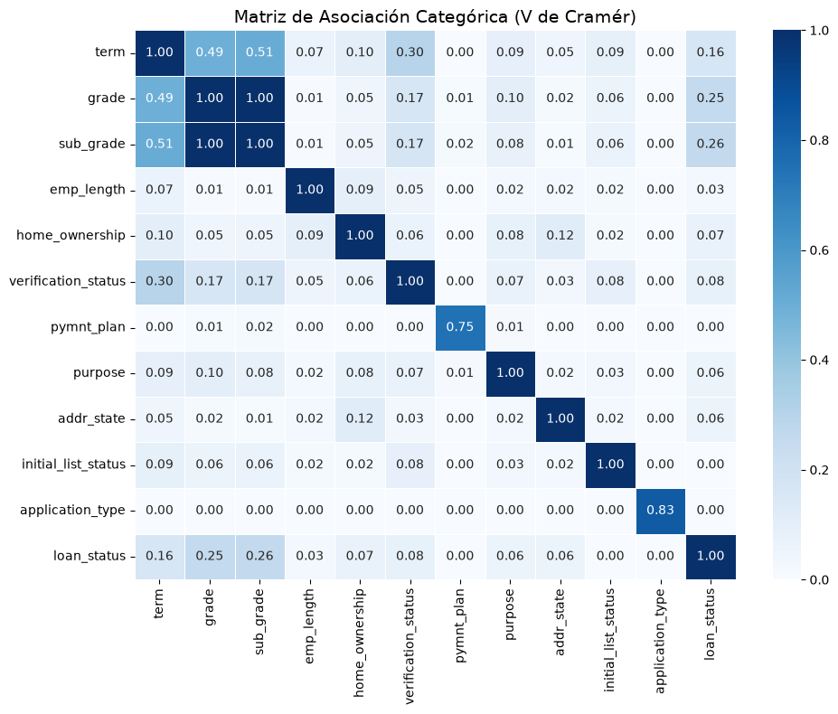

*Fuente:* elaboración propia, `notebooks/procesamiento.ipynb` (celda 14).

**Limitación.** La selección por ANOVA, correlación y V de Cramér se hizo con todos los créditos, incluidos los de validación y prueba. Es una fuga menor: las variables se escogieron mirando también el periodo con el que después se evalúa. **[PENDIENTE: repetir la selección solo con entrenamiento o discutirlo.]**

### 2.4 Análisis descriptivo e hipótesis

Antes de entrenar los modelos, el equipo formuló cuatro hipótesis sobre qué hace más riesgosa a una persona; están en el borrador `reporte/blog_post_tecnico_(Borrador).md`. Las contrastamos solo con el periodo de entrenamiento, para no mirar los créditos con los que después se evalúa (Tabla 3 y Figura 3). La tasa promedio de incumplimiento en ese periodo es 21.7 %.

**Tabla 3.** *Hipótesis y tasa de incumplimiento en el periodo de entrenamiento.*

| Hipótesis | Menor riesgo | Mayor riesgo | ¿Se confirma? |
|---|---|---|---|
| H1. A mayor `dti`, más incumplimiento | 1.er quintil ($\le 10.07$): 15.8 % | 5.º quintil ($> 24.02$): 28.8 % | Sí: sube en cada quintil |
| H2. A mayor `int_rate` y peor `sub_grade`, más incumplimiento | 1.er quintil de tasa ($\le 10.99$ %): 9.5 %. Letra A: 7.4 % | 5.º quintil de tasa ($> 18.25$ %): 36.3 %. Letra G: 47.1 % | Sí: sube en cada quintil y en cada letra |
| H3. A 60 meses se incumple más que a 36 | 36 meses: 18.0 % | 60 meses: 35.2 % | Sí |
| H4. Más años de empleo, menos incumplimiento | — | — | No: la tasa va de 20.8 % a 23.5 % sin tendencia; menos de un año: 22.5 %; diez o más: 21.2 % |

*Fuente:* elaboración propia, `python scripts/parte1_descriptivo.py` (`resultados/parte1/descriptivo_*.csv`).

**Figura 3.** *Tasa de incumplimiento en entrenamiento según cada hipótesis. La línea punteada es la tasa promedio.*

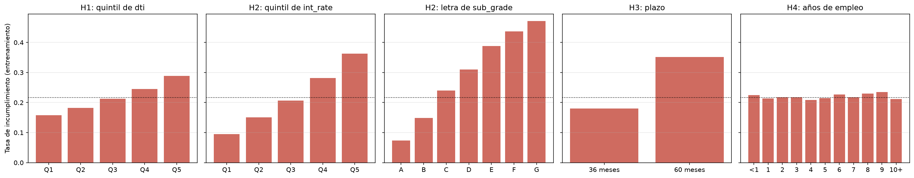

*Fuente:* elaboración propia, `python scripts/parte1_descriptivo.py`.

Las tres primeras se confirman con claridad. La cuarta no: la antigüedad laboral casi no cambia la tasa, lo que coincide con su V de Cramér de 0.03 y con que se haya descartado en la selección (Sección 2.3). Que una variable separe por sí sola no dice cuánto aporta cuando ya están las demás; eso se analiza con los modelos en la Sección 3.7.

---

## 3. Parte 1: probabilidad de incumplimiento

### 3.1 Partición temporal

Ordenamos los créditos por fecha de originación (`issue_d`) y cortamos en fechas fijas, definidas en `src/preprocesamiento.py`. Validación empieza en mayo de 2014 y prueba en noviembre de 2014 (Tabla 4). Así se simula el uso real: el modelo se entrena con créditos pasados y se evalúa con créditos posteriores. La Parte 2 usa exactamente los mismos cortes.

**Tabla 4.** *Partición temporal de la Parte 1.*

| Conjunto | Desde | Hasta | Créditos | % del total | Tasa de incumplimiento |
|---|---|---|---|---|---|
| Entrenamiento | 2012-08 | 2014-04 | 118,372 | 61.3 % | 21.7 % |
| Validación | 2014-05 | 2014-10 | 38,300 | 19.8 % | 26.4 % |
| Prueba | 2014-11 | 2015-12 | 36,378 | 18.8 % | 25.2 % |

*Fuente:* elaboración propia, `notebooks/clasificacion.ipynb` (celdas 3 y 4).

La tasa de incumplimiento sube en validación y prueba, y la Figura 4 muestra por qué. La proporción de créditos con un estado definido pasa de más de 92 % en las cosechas de 2012 a 41 % a comienzos de 2014, 23 % a finales de 2014 y 1.6 % en el último trimestre de 2015. Los demás siguen `Current` y se excluyen.

En una cosecha reciente, los créditos que ya tienen estado final son los que terminaron pronto: los que incumplieron en los primeros meses o los que se pagaron por adelantado. Eso explicaría que la tasa de incumplimiento de los incluidos suba de 16 % en 2012 a 28 % a comienzos de 2015 y vuelva a caer a 9.7 % en el último trimestre de 2015.

La partición temporal es coherente con el caso de uso, pero el conjunto de prueba no representa a todos los créditos otorgados en su periodo, sino a los que ya terminaron. Hay que tenerlo presente al leer todas las métricas de prueba.

**Figura 4.** *Proporción de créditos excluidos (estado NA) y tasa de incumplimiento de los incluidos, por trimestre de originación.*

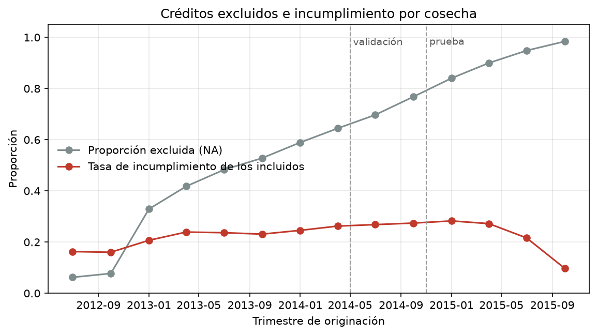

*Fuente:* elaboración propia, `python scripts/parte1_descriptivo.py`.

Todas las variables se estandarizan con `StandardScaler`, ajustado solo con entrenamiento.

### 3.2 Modelo de referencia: regresión logística

Regresión logística de scikit-learn con penalización $L_2$ ($C = 1$, valor por defecto), `class_weight='balanced'` y `max_iter=5000`. Tiene **83 parámetros** (82 coeficientes y el intercepto) y se ajusta en 0.3 s. La configuración es la de `notebooks/regresion_logistica.ipynb`. `scripts/parte1_evaluacion.py` la reajusta igual, porque es determinista, la guarda en `weights/regresion_logistica_pd.joblib` y obtiene el mismo AUC de validación del notebook (0.7100).

`class_weight='balanced'` le da a cada clase un peso inversamente proporcional a su frecuencia. La razón entre el peso de los incumplimientos y el de los buenos es $N_0/N_1 = 3.61$, el mismo `pos_weight` de la red. Por eso sus probabilidades se corrigen igual que las de la red, con $p = \sigma(z - \ln 3.61)$ (Sección 7.3).

### 3.3 Red neuronal

La red de `notebooks/clasificacion.ipynb` es un perceptrón multicapa en PyTorch. Cada capa oculta aplica una transformación lineal, normalización por lotes (*batch normalization*), ReLU y *dropout*:

$$
82 \;\to\; 64 \;\to\; 32 \;\to\; 16 \;\to\; 1
$$

El *dropout* es de 0.2 en las dos primeras capas ocultas; la tercera no tiene. La salida es un logit, y la probabilidad se obtiene con la sigmoide. Tiene **8,161 parámetros entrenables**. La llamamos la red base.

- **Pérdida:** entropía cruzada binaria ponderada (`BCEWithLogitsLoss`) con `pos_weight` $= N_0/N_1 = 3.61$, calculado con entrenamiento. Como el peso desplaza el logit, las probabilidades se corrigen con $p = \sigma(z - \ln 3.61)$ (derivación en la Sección 7.3).
- **Optimización:** Adam con tasa de aprendizaje $10^{-3}$, penalización $L_2$ (`weight_decay`) de $10^{-4}$ y lotes de 512. La tasa se reduce a la mitad tras 3 épocas sin mejorar el AUC de validación (`ReduceLROnPlateau`).
- **Parada temprana:** máximo 30 épocas, paciencia de 10 sobre el AUC de validación, restaurando los mejores pesos.

### 3.4 Resultados

La Tabla 5 compara la regresión logística con la red base guardada por el notebook, en validación y prueba.

**Tabla 5.** *Discriminación y calibración en la Parte 1.*

| Modelo | Conjunto | AUC | Gini | KS | Brier | Brier de referencia |
|---|---|---|---|---|---|---|
| Regresión logística | Validación | 0.7100 | 0.4200 | 0.3086 | 0.1761 | 0.1944 |
| Regresión logística | Prueba | 0.7033 | 0.4066 | 0.3057 | 0.1722 | 0.1886 |
| Red neuronal (base) | Validación | 0.7131 | 0.4262 | 0.3122 | 0.1744 | 0.1944 |
| Red neuronal (base) | Prueba | 0.7033 | 0.4066 | 0.2997 | 0.1709 | 0.1886 |
| Logística sin corregir | Validación | 0.7100 | 0.4200 | 0.3086 | 0.2170 | 0.1944 |
| Logística sin corregir | Prueba | 0.7033 | 0.4066 | 0.3057 | 0.2209 | 0.1886 |

*Fuente:* elaboración propia, `python scripts/parte1_evaluacion.py` (`resultados/parte1/metricas_pd.csv`). El Brier de referencia es el de un modelo que predice siempre la tasa de incumplimiento del conjunto.

1. **En prueba, la red y la logística tienen el mismo AUC** (0.7033, hasta el cuarto decimal). La logística tiene mejor KS (0.3057 frente a 0.2997) y la red, un Brier un poco menor (0.1709 frente a 0.1722). En validación, la red gana 0.0031 de AUC.
2. **La corrección del peso de clase es indispensable.** Sin ella, la logística tiene un Brier de 0.2209 en prueba: es peor que predecir siempre la tasa promedio (0.1886). La corrección no cambia el AUC ni el KS, porque no altera el orden de los créditos, pero arregla la calibración.
3. **Calibración (Figura 5).** Las dos curvas corregidas quedan cerca de la diagonal en prueba. En validación ambas subestiman el incumplimiento en los deciles más riesgosos, porque la tasa de validación (26.4 %) es mayor que la de entrenamiento (21.7 %). En prueba, la PD media de la red es 23.7 % y la tasa observada, 25.2 %.

**Figura 5.** *Curvas de calibración por deciles de probabilidad predicha.*

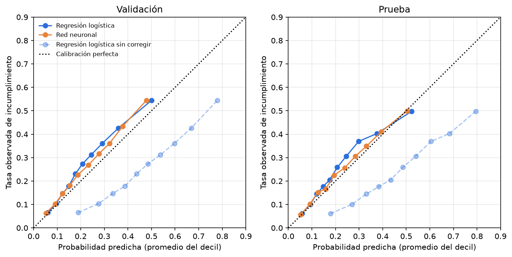

*Fuente:* elaboración propia, `python scripts/parte1_evaluacion.py`.

Las curvas ROC de los dos modelos en prueba prácticamente se superponen (Figura 6). La Figura 7 muestra el estadístico KS de la red: la distancia máxima entre las distribuciones acumuladas de la probabilidad predicha de buenos y malos pagadores.

**Figura 6.** *Curvas ROC en prueba.*

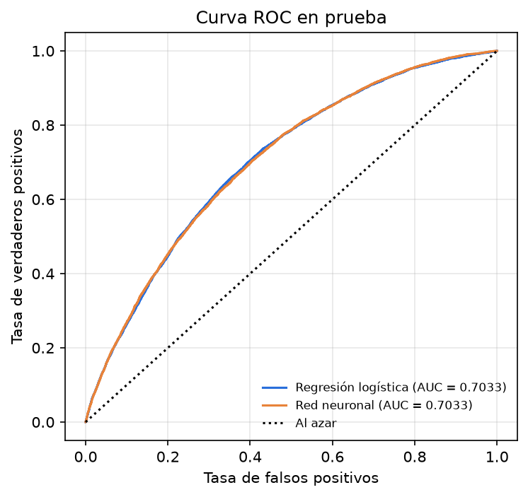

*Fuente:* elaboración propia, `python scripts/parte1_evaluacion.py`.

**Figura 7.** *Estadístico KS de la red neuronal en prueba.*

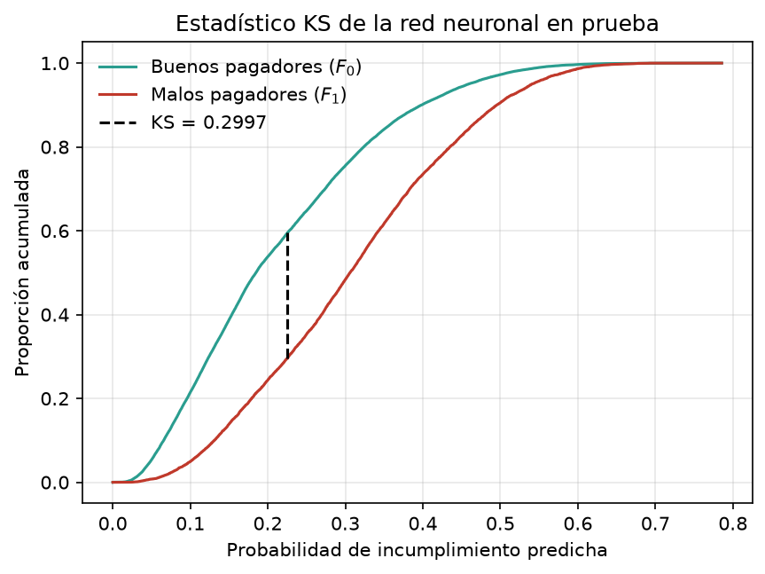

*Fuente:* elaboración propia, `python scripts/parte1_evaluacion.py`.

### 3.5 Búsqueda de hiperparámetros y semillas

La red base se fijó a mano, así que después hicimos una búsqueda aleatoria (Bergstra y Bengio, 2012). Usamos el mismo espacio de la Parte 2 (Tabla 16), sin la opción de pérdida, porque aquí siempre es la entropía cruzada ponderada. Fueron 30 configuraciones al azar con semilla 56, más la red base como candidata. Cada una se entrenó con el mismo procedimiento, y el criterio de selección fue el AUC de validación.

Las 31 configuraciones tardaron 9.6 minutos y quedaron entre 0.7072 y 0.7148 de AUC de validación. La Tabla 6 muestra las cinco mejores.

**Tabla 6.** *Las cinco mejores configuraciones de la búsqueda (AUC de validación, semilla 56).*

| Capas ocultas | Activación | *Dropout* | `weight_decay` | Tasa de aprendizaje | Lote | Parámetros | AUC validación |
|---|---|---|---|---|---|---|---|
| [32] | ReLU | 0.3 | $10^{-4}$ | $10^{-3}$ | 512 | 2,753 | 0.7148 |
| [64, 32] | ReLU | 0.3 | 0 | $10^{-3}$ | 256 | 7,617 | 0.7142 |
| [64] | Leaky ReLU | 0.2 | 0 | $3\cdot10^{-4}$ | 256 | 5,505 | 0.7141 |
| [64, 32] | Leaky ReLU | 0.3 | $10^{-3}$ | $3\cdot10^{-4}$ | 1024 | 7,617 | 0.7136 |
| [64, 32, 16] (red base) | ReLU | 0.2 (0 en la última) | $10^{-4}$ | $10^{-3}$ | 512 | 8,161 | 0.7133 |

*Fuente:* elaboración propia, `python scripts/parte1_busqueda.py` (`resultados/busqueda_pd.csv` y `resultados/config_final_pd.json`).

La ganadora es la red más pequeña de la búsqueda: una sola capa oculta de 32 neuronas. La diferencia con la red base (0.0015 de AUC) es del mismo orden que la variabilidad entre semillas. Por eso entrenamos ambas con 30 semillas (0 a 29); los resultados están en la Tabla 7.

**Tabla 7.** *Métricas en prueba de las dos redes con 30 semillas.*

| Red | Métrica | Media | Desv. estándar | Mejor | Peor |
|---|---|---|---|---|---|
| Búsqueda: [32], 2,753 parámetros | AUC | 0.7043 | 0.0007 | 0.7060 | 0.7030 |
| | Gini | 0.4086 | 0.0015 | 0.4120 | 0.4060 |
| | KS | 0.3043 | 0.0015 | 0.3074 | 0.3008 |
| | Brier | 0.1713 | 0.0002 | 0.1709 | 0.1720 |
| Base: [64, 32, 16], 8,161 parámetros | AUC | 0.7031 | 0.0011 | 0.7050 | 0.7009 |
| | Gini | 0.4062 | 0.0023 | 0.4100 | 0.4018 |
| | KS | 0.3004 | 0.0028 | 0.3073 | 0.2958 |
| | Brier | 0.1713 | 0.0004 | 0.1706 | 0.1722 |

*Fuente:* elaboración propia, `python scripts/parte1_busqueda.py` (`resultados/semillas_pd.csv`). Para el Brier, mejor es menor.

La red de la búsqueda es un poco mejor y más estable que la base, con un tercio de los parámetros. Las dos quedan a menos de 0.002 de AUC de la regresión logística (Tabla 5).

**Red final.** Mantenemos como final la red base (`weights/modelo_clasificador.pth`), que es la que usan la scorecard, la aplicación y la pérdida esperada. Su diferencia con la ganadora de la búsqueda es de 0.0012 de AUC en prueba, y el Brier es el mismo (0.1713), así que no tiene importancia práctica para la decisión de crédito. La búsqueda la reportamos como evidencia de que ajustar la arquitectura no cambia el desempeño de forma relevante. La red de la búsqueda queda guardada en `weights/modelo_pd_busqueda.pth`.

### 3.6 Scorecard

El puntaje es una transformación afín del logaritmo de las odds de ser buen pagador, $\ln\frac{1-p}{p}$. Se fija con tres parámetros: el puntaje base, las odds de referencia en ese puntaje y los puntos para duplicar las odds (PDO). La derivación completa está en la Sección 7.8 y el código, en `scripts/scorecard_engine.py`:

$$
\text{Factor} = \frac{\text{PDO}}{\ln 2}, \qquad \text{Offset} = \text{Puntaje}_0 - \text{Factor}\cdot\ln(\text{Odds}_0), \qquad \text{Puntaje}(p) = \text{Offset} - \text{Factor}\cdot\ln\frac{p}{1-p}.
$$

Usamos un puntaje base de 600, odds de 50:1 y PDO de 20, los valores que trae el motor. Con ellos, Factor $= 28.8539$ y Offset $= 487.1229$ (Tabla 8). Los tres se cambian con `--puntaje_base`, `--odds_base` y `--pdo`, o en la aplicación.

**Tabla 8.** *Puntaje según la probabilidad de incumplimiento (puntaje base 600, odds 50:1, PDO 20).*

| Probabilidad de incumplimiento | Odds (buenos : malos) | Puntaje |
|---|---|---|
| 1.96 % | 50 : 1 | 600 |
| 5 % | 19 : 1 | 572 |
| 10 % | 9 : 1 | 551 |
| 21.7 % (tasa de entrenamiento) | 3.6 : 1 | 524 |
| 50 % | 1 : 1 | 487 |
| 80 % | 0.25 : 1 | 447 |

*Fuente:* elaboración propia con las fórmulas de `scripts/scorecard_engine.py`.

**Distribución en prueba.** Con la red base, los puntajes de prueba tienen media 526 y desviación estándar 25. El 5 % más bajo queda por debajo de 488, la mediana es 524 y el 5 % más alto supera 570 (Figura 8). Como la cartera tiene una tasa de incumplimiento cercana a 25 % y las odds de referencia son 50:1, casi todos los créditos quedan por debajo del puntaje base. **[PENDIENTE: decidir con el equipo si se mantienen estos parámetros.]**

**¿Ordena bien?** Sí. Al dividir los créditos de prueba en deciles de puntaje, la tasa observada de incumplimiento baja en cada decil: va de 50.0 % en el de menor puntaje a 5.7 % en el de mayor puntaje (Tabla 9). La PD media de la red queda un poco por debajo de la tasa observada en casi todos los deciles, por lo mismo que se ve en la calibración.

**Tabla 9.** *Incumplimiento por decil de puntaje en prueba (red base).*

| Decil | Puntaje | PD media | Tasa observada |
|---|---|---|---|
| 1 | 450 – 495 | 50.4 % | 50.0 % |
| 2 | 495 – 504 | 39.4 % | 40.9 % |
| 3 | 504 – 511 | 33.1 % | 35.1 % |
| 4 | 511 – 517 | 28.4 % | 29.9 % |
| 5 | 517 – 524 | 23.9 % | 26.2 % |
| 6 | 524 – 532 | 19.5 % | 22.3 % |
| 7 | 532 – 539 | 15.8 % | 16.9 % |
| 8 | 539 – 548 | 12.6 % | 15.0 % |
| 9 | 548 – 560 | 9.2 % | 10.3 % |
| 10 | 560 – 737 | 5.2 % | 5.7 % |

*Fuente:* elaboración propia, `python scripts/parte1_evaluacion.py` (`resultados/parte1/deciles_puntaje_prueba.csv`). Cada decil tiene 3,637 o 3,638 créditos.

**Figura 8.** *Distribución de puntajes en prueba por resultado, e incumplimiento por decil de puntaje.*

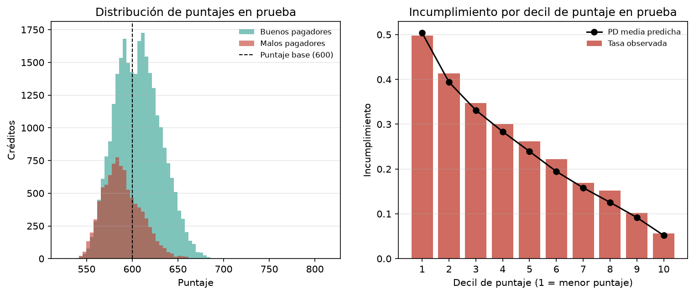

*Fuente:* elaboración propia, `python scripts/parte1_evaluacion.py`.

**Cómo salen los puntos del modelo.** En las dos versiones, el puntaje de un crédito es $\text{Offset} - \text{Factor}\,[f(\mathbf{x}) - \ln w]$, donde $f(\mathbf{x})$ es el logit del modelo y $w = 3.61$. Lo que cambia es cómo se reparte ese puntaje entre las variables.

- **Logística: scorecard continua exacta.** El logit es una suma, $\beta_0 + \sum_j \beta_j (x_j - \mu_j)/s_j$, donde $\mu_j$ y $s_j$ son la media y la desviación de entrenamiento. Entonces el puntaje es el de un cliente promedio, 528.5 puntos, más los puntos de cada variable, $-\text{Factor}\cdot\beta_j\,(x_j - \mu_j)/s_j$. La Tabla 10 muestra cuántos puntos suma o resta cada unidad de las variables principales. Comprobamos que la suma de los puntos reproduce el puntaje calculado desde la probabilidad, con una diferencia máxima de $10^{-13}$.
- **Red neuronal: atribución.** El logit de la red no es una suma por variable. Usamos gradientes integrados (Sundararajan et al., 2017), que reparten $f(\mathbf{x}) - f(\mathbf{x}_0)$ entre las variables y cuyas atribuciones suman exactamente esa diferencia (completitud). Como línea base $\mathbf{x}_0$ tomamos el cliente promedio de entrenamiento ($\tilde{\mathbf{x}} = 0$), que tiene 536.9 puntos. Entonces los puntos de cada variable son $-\text{Factor}$ por su atribución. Con 256 pasos de integración, la suma de los puntos difiere del puntaje en 0.03 puntos en promedio y en 0.6 como máximo, en 5,000 créditos de prueba. La Figura 11 muestra un ejemplo, y la aplicación lo calcula para cada solicitante.

**Tabla 10.** *Puntos de la scorecard continua de la regresión logística.*

| Variable | Puntos por unidad | Unidad |
|---|---|---|
| `int_rate` | −2.95 | cada punto porcentual de tasa |
| `dti` | −0.70 | cada punto de la relación deuda/ingreso |
| `annual_inc` | +1.21 | cada 10,000 USD de ingreso |
| `loan_amnt` | −0.45 | cada 1,000 USD de monto |
| `open_acc` | −0.80 | cada línea de crédito abierta |
| `total_acc` | +0.45 | cada línea de crédito en total |
| `inq_last_6mths` | −1.22 | cada consulta de crédito reciente |
| `revol_util` | −0.08 | cada punto porcentual de uso del cupo rotativo |
| `term_ 60 months` | −11.90 | plazo de 60 meses frente a 36 |
| `purpose_small_business` | −23.07 | propósito pequeño negocio frente a carro |
| `purpose_debt_consolidation` | −8.78 | propósito consolidar deudas frente a carro |
| `home_ownership_RENT` | −1.98 | vivienda arrendada frente a `ANY` |
| `sub_grade` | +0.06 | cada escalón de subcalificación (A1 = 0, …, G5 = 34) |

*Fuente:* elaboración propia, `python scripts/parte1_evaluacion.py` (`resultados/parte1/scorecard_logistica_puntos.csv`, con las 82 variables).

### 3.7 Variables de riesgo

Usamos dos métodos de interpretabilidad que no dependen de la forma del modelo.

1. **Importancia por permutación** (Breiman, 2001; Fisher et al., 2019). Mide cuánto cae el AUC de prueba cuando se desordena una variable, rompiendo su relación con el resultado sin cambiar su distribución. Las indicadoras de una misma variable (por ejemplo, los 49 estados) se permutan juntas. Como `int_rate` y `sub_grade` están muy asociadas, también las permutamos juntas: con una sola desordenada, el modelo todavía puede sacar la información de la otra. Usamos 5 repeticiones por variable.
2. **Gradientes integrados** (Sundararajan et al., 2017), en la red. Da cuántos puntos aporta cada variable a cada crédito (Sección 3.6). Su promedio en valor absoluto sirve como importancia global.

**Tabla 11.** *Caída del AUC en prueba al permutar cada grupo de variables (promedio de 5 repeticiones).*

| Grupo | Red neuronal | Regresión logística |
|---|---|---|
| `int_rate` + `sub_grade` (juntas) | 0.069 | 0.078 |
| `sub_grade` | 0.043 | 0.000 |
| `int_rate` | 0.004 | 0.080 |
| `annual_inc` | 0.019 | 0.006 |
| `dti` | 0.013 | 0.017 |
| `loan_amnt` | 0.014 | 0.005 |
| `total_acc` | 0.011 | 0.016 |
| `addr_state` | 0.007 | 0.005 |
| `revol_util` | 0.006 | 0.005 |
| `home_ownership` | 0.006 | 0.003 |
| `term` | 0.006 | 0.004 |

*Fuente:* elaboración propia, `python scripts/parte1_evaluacion.py` (`resultados/parte1/importancia_permutacion_prueba.csv`, con todos los grupos).

**Figura 9.** *Los 15 coeficientes más positivos y los 15 más negativos de la regresión logística.*

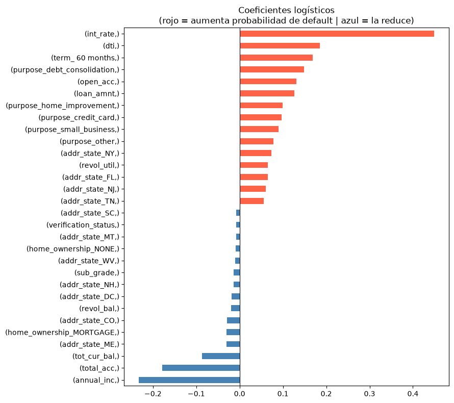

*Fuente:* elaboración propia, `notebooks/regresion_logistica.ipynb` (celda 11).

**Figura 10.** *Importancia de las variables: caída del AUC al permutar (ambos modelos) y puntos absolutos promedio con gradientes integrados (red).*

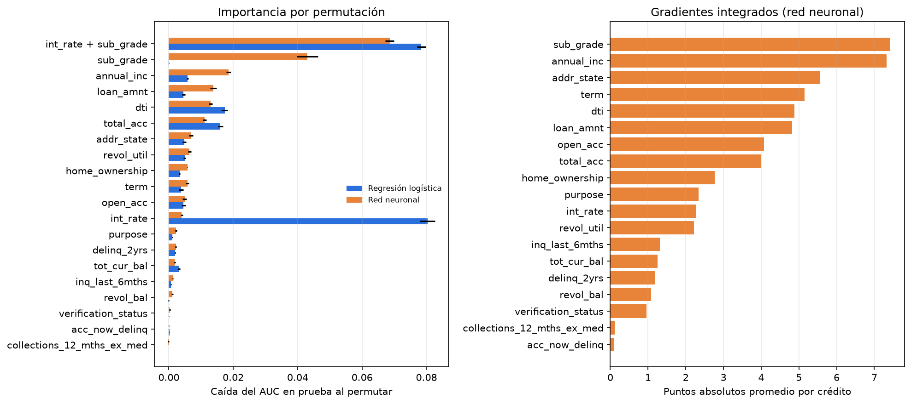

*Fuente:* elaboración propia, `python scripts/parte1_evaluacion.py`.

**Figura 11.** *Puntos por variable de un crédito de prueba con PD mediana, frente al cliente promedio.*

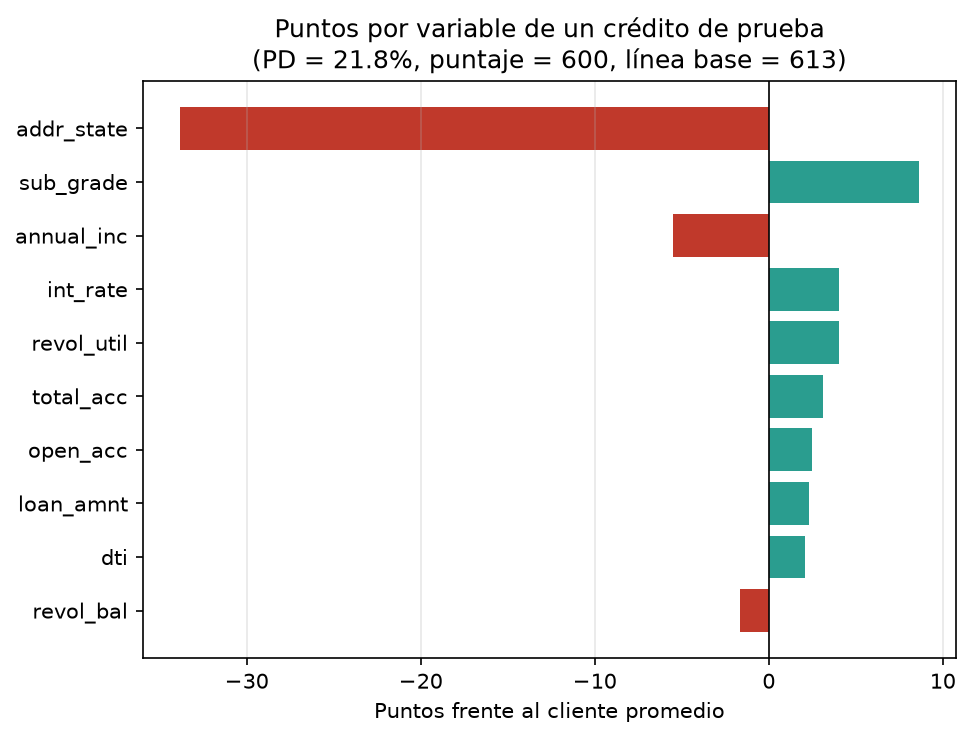

*Fuente:* elaboración propia, `python scripts/parte1_evaluacion.py`.

Lo que hace más riesgosa a una persona, según ambos modelos (Tabla 11, Figura 9 y Figura 10):

1. **Las condiciones que asigna la plataforma, `int_rate` y `sub_grade`, son lo más importante.** Al permutarlas juntas, el AUC cae 0.07 en la red y 0.08 en la logística. Pero cada modelo usa una distinta: la logística se apoya en la tasa (su coeficiente de `sub_grade` es −0.013, prácticamente cero y con signo contrario al esperado), y la red, en la subcalificación. Llevan casi la misma información; por eso, con una sola permutada, el modelo que se apoya en la otra apenas lo nota. Así se explica el signo raro de `sub_grade` en la logística: es colinealidad, no un efecto real.
2. **Después vienen la capacidad de pago y el endeudamiento:** el ingreso (`annual_inc`, que reduce el riesgo), la relación deuda/ingreso (`dti`, que lo aumenta), el monto (`loan_amnt`, que lo aumenta) y el número de líneas de crédito (`total_acc` reduce el riesgo y `open_acc` lo aumenta).
3. **El plazo de 60 meses aumenta el riesgo** (−11.9 puntos en la logística) y el propósito importa: un pequeño negocio resta 23 puntos frente a un carro. Estas variables pesan menos en la permutación porque afectan a menos créditos.
4. **Casi no aportan** las cuentas actualmente en mora, los cobros recientes y la verificación del ingreso. Esto coincide con su baja asociación en la selección de variables.

Esto es coherente con H1 a H3 (Sección 2.4), ahora con todas las variables juntas.

En los gradientes integrados, `addr_state` aparece con más puntos que en la permutación (5.6 puntos absolutos promedio frente a una caída de AUC de 0.007). Se debe a la línea base: el cliente promedio tiene una fracción de cada uno de los 49 estados, así que cualquier persona real se aleja de él en todas esas indicadoras a la vez. Para leer los puntos por variable hay que tener en cuenta esa elección.

---

## 4. Parte 2: pérdida dado incumplimiento

El detalle de esta parte está en `docs/parte2_lgd.md` y el código, en `notebooks/regresion.ipynb`.

### 4.1 Qué créditos entran

**Tabla 12.** *Créditos que incumplieron, según su estado.*

| `loan_status` | Créditos | % con `recoveries > 0` | `out_prncp` promedio (USD) |
|---|---|---|---|
| Charged Off | 45,248 | 53.45 | 0 |
| Does not meet the credit policy. Status:Charged Off | 761 | 64.39 | 0 |
| Default | 1,219 | 0.00 | 11,595 |
| Late (31-120 days) | 11,591 | 0.00 | 11,690 |

*Fuente:* elaboración propia, `notebooks/regresion.ipynb` (celda 4).

`Default` y `Late (31-120 days)` todavía no se han castigado (Tabla 12): no tienen recuperaciones y aún deben capital, así que su pérdida final no es observable. Si se incluyeran, todos saldrían con pérdida total. El modelo se entrena solo con los **46,009 castigados**. Como estima la pérdida *si* el crédito incumpliera, después se puede aplicar a cualquier crédito.

### 4.2 Variable objetivo

Las definiciones vienen del diccionario (Tabla 13):

**Tabla 13.** *Campos usados para construir la LGD.*

| Campo | Definición en el diccionario | Rol |
|---|---|---|
| `funded_amnt` | *The total amount committed to that loan at that point in time.* | Monto desembolsado |
| `total_rec_prncp` | *Principal received to date.* | Capital pagado antes del castigo |
| `recoveries` | *post charge off gross recovery* | Recuperación bruta |
| `collection_recovery_fee` | *post charge off collection fee* | Costo de cobranza |

*Fuente:* `datasets/LCDataDictionary.xlsx`.

$$
EAD_i = \text{funded\_amnt}_i - \text{total\_rec\_prncp}_i, \qquad
R_i = \text{recoveries}_i - \text{collection\_recovery\_fee}_i, \qquad
LGD_i = \min\!\left(1,\ \max\!\left(0,\ 1 - \frac{R_i}{EAD_i}\right)\right).
$$

En todos los castigados se cumple $EAD > 0$ y `out_prncp` $= 0$. Solo 38 créditos dan LGD negativa antes del recorte, porque lo recuperado puede cubrir también intereses y cargos; ninguno da LGD mayor que 1.

### 4.3 Distribución

La LGD tiene media 0.930, mediana 0.981 y desviación estándar 0.098. El **46.4 %** de los castigados tiene LGD $= 1$, es decir, no se recuperó nada (Figura 12). Hay picos: la razón `recoveries / EAD` se concentra cerca de 5.7 % y 14 %, y la razón `collection_recovery_fee / recoveries`, cerca de 1 % y 18 %. Esto sugiere que la LGD depende más de reglas del proceso de recobro que del perfil del cliente. **[PENDIENTE: hipótesis sin verificar con fuentes.]**

**Figura 12.** *Distribución de la LGD en los créditos castigados.*

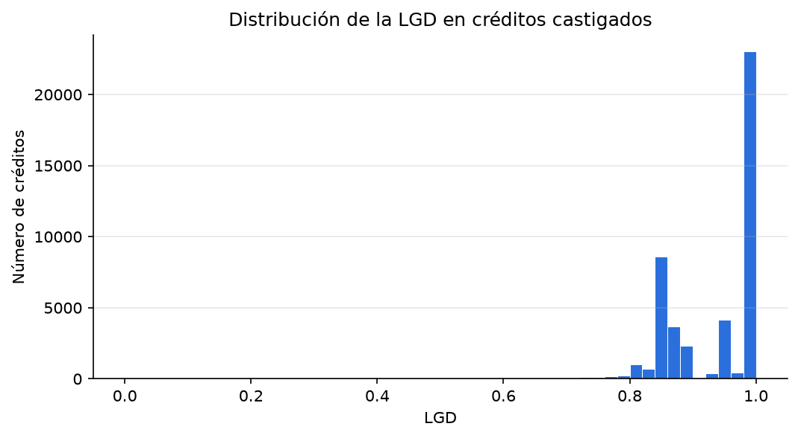

*Fuente:* elaboración propia, `notebooks/regresion.ipynb` (celda 6).

**Tabla 14.** *LGD por año de originación.*

| Año | Créditos | LGD media | % sin recuperación |
|---|---|---|---|
| 2007 | 158 | 0.921 | 36.7 |
| 2008 | 496 | 0.931 | 44.2 |
| 2009 | 723 | 0.926 | 34.0 |
| 2010 | 1,753 | 0.925 | 25.6 |
| 2011 | 3,205 | 0.922 | 22.7 |
| 2012 | 8,084 | 0.911 | 25.2 |
| 2013 | 14,836 | 0.918 | 42.9 |
| 2014 | 13,981 | 0.945 | 62.7 |
| 2015 | 2,773 | 0.981 | 89.0 |

*Fuente:* elaboración propia, `notebooks/regresion.ipynb` (celda 8).

### 4.4 Limitaciones de la LGD observada

1. **Recobro incompleto.** El conjunto es una foto en un momento dado. En las cosechas recientes la cobranza no ha terminado, así que su LGD está sobreestimada; se ve en 2014 y 2015 en la Tabla 14.
2. **Sin descuento en el tiempo.** El conjunto no trae las fechas de cada recuperación, así que no se pueden descontar al momento del incumplimiento. La pérdida económica real es mayor que la calculada.
3. **EAD solo con capital.** No incluye intereses causados y no pagados.
4. **Se excluyen `Default` y `Late`.** Se supone que, al castigarse, se comportarán como los ya castigados.
5. **Costos indirectos.** `collection_recovery_fee` solo cubre el costo de la agencia de cobranza.

### 4.5 Datos y partición

Se usan las mismas 82 variables y los mismos cortes de la Parte 1. Al quitar las filas con nulos quedan **33,110 castigados**, originados entre agosto de 2012 y septiembre de 2015 (Tabla 15). El escalado se ajusta solo con entrenamiento.

**Tabla 15.** *Partición temporal de la Parte 2.*

| Conjunto | Desde | Hasta | Créditos | LGD media |
|---|---|---|---|---|
| Entrenamiento | 2012-08 | 2014-04 | 22,372 | 0.919 |
| Validación | 2014-05 | 2014-10 | 7,112 | 0.951 |
| Prueba | 2014-11 | 2015-09 | 3,626 | 0.975 |

*Fuente:* elaboración propia, `notebooks/regresion.ipynb` (celda 10).

La LGD media sube en validación y prueba por el recobro incompleto (Sección 4.4). Esto penaliza a cualquier modelo entrenado con cosechas más antiguas.

### 4.6 Modelos

**Referencia.** Regresión lineal por mínimos cuadrados, con 83 parámetros. En prueba ninguna predicción cae fuera de $[0, 1]$, pero el modelo no lo garantiza.

**Red neuronal.** La misma estructura por capa de la Parte 1 (lineal, normalización por lotes, activación y *dropout*). La salida pasa por una sigmoide, porque la LGD está en $[0, 1]$. Se compararon dos pérdidas, ambas derivadas en la Sección 7.3: la entropía cruzada con objetivo continuo (Papke y Wooldridge, 1996) y el error cuadrático medio. Las dos se minimizan en la media condicional $E[LGD \mid \mathbf{x}]$, que es lo que necesita $E[L]$. Regularización: *dropout*, penalización $L_2$ y parada temprana con paciencia de 10 sobre la pérdida de validación, con un máximo de 100 épocas.

**Búsqueda.** Búsqueda aleatoria (Bergstra y Bengio, 2012) de 30 configuraciones, con semilla 56, sobre el espacio de la Tabla 16. El criterio fue el menor RMSE en validación, igual para todas; no se puede comparar por la pérdida porque cada configuración usa la suya.

**Tabla 16.** *Espacio de búsqueda de la red de LGD.*

| Hiperparámetro | Valores |
|---|---|
| Capas ocultas | [32], [64], [64, 32], [128, 64], [64, 32, 16], [128, 64, 32] |
| Activación | ReLU, tanh, Leaky ReLU |
| *Dropout* | 0, 0.1, 0.2, 0.3 |
| `weight_decay` ($L_2$) | 0, $10^{-5}$, $10^{-4}$, $10^{-3}$ |
| Tasa de aprendizaje | $10^{-4}$, $3\cdot10^{-4}$, $10^{-3}$, $3\cdot10^{-3}$ |
| Tamaño de lote | 256, 512, 1024 |
| Pérdida | Entropía cruzada, error cuadrático medio |

*Fuente:* `notebooks/regresion.ipynb` (celda 2); resultados en `resultados/busqueda_lgd.csv`.

La configuración ganadora tiene capas [64, 32, 16], tanh, *dropout* de 0.2, `weight_decay` de $10^{-5}$, tasa de aprendizaje de $3\cdot10^{-4}$, lotes de 512 y error cuadrático medio. Tiene **8,161 parámetros** y está guardada en `resultados/config_final_lgd.json`. Ocho de las diez mejores configuraciones usan el error cuadrático medio. La Figura 13 muestra sus curvas de entrenamiento. Que la pérdida de validación quede por debajo de la de entrenamiento no es un error: la LGD de validación está más concentrada cerca de 1, así que tiene menos varianza.

**Figura 13.** *Curvas de entrenamiento de la red de LGD (configuración final, semilla 56).*

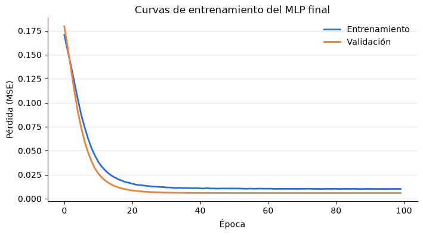

*Fuente:* elaboración propia, `notebooks/regresion.ipynb` (celda 25).

### 4.7 Resultados

La configuración final se entrenó con 30 semillas. La variabilidad entre semillas es pequeña frente a las diferencias entre modelos (Tabla 17).

**Tabla 17.** *Red de LGD con 30 semillas (0 a 29).*

| | MAE validación | RMSE validación | MAE prueba | RMSE prueba |
|---|---|---|---|---|
| Media | 0.0648 | 0.0770 | 0.0594 | 0.0805 |
| Desviación estándar | 0.0006 | 0.0002 | 0.0014 | 0.0007 |
| Mejor | 0.0637 | 0.0766 | 0.0571 | 0.0794 |
| Peor | 0.0658 | 0.0776 | 0.0622 | 0.0820 |

*Fuente:* elaboración propia, `notebooks/regresion.ipynb` (celda 22); detalle en `resultados/semillas_lgd.csv`.

**Tabla 18.** *Comparación de modelos de LGD (red con semilla 56).*

| Modelo | Conjunto | MAE | RMSE | RMSE sin sesgo | Sesgo | Spearman |
|---|---|---|---|---|---|---|
| Media de entrenamiento | Validación | 0.0773 | 0.0837 | 0.0772 | −0.0324 | — |
| | Prueba | 0.0827 | 0.0950 | 0.0764 | −0.0565 | — |
| Regresión lineal | Entrenamiento | 0.0734 | 0.0909 | 0.0909 | 0.0000 | 0.194 |
| | Validación | 0.0738 | 0.0815 | 0.0767 | −0.0275 | 0.148 |
| | Prueba | 0.0775 | 0.0926 | 0.0773 | −0.0510 | 0.133 |
| Red neuronal | Entrenamiento | 0.0752 | 0.0965 | 0.0911 | +0.0317 | 0.145 |
| | Validación | 0.0645 | 0.0765 | 0.0765 | −0.0004 | 0.136 |
| | Prueba | 0.0594 | 0.0802 | 0.0762 | −0.0251 | 0.117 |

*Fuente:* elaboración propia, `notebooks/regresion.ipynb` (celda 28). El sesgo es la media predicha menos la media observada; el RMSE sin sesgo se calcula después de restarle su media a cada serie; Spearman es la correlación de rangos entre la predicción y la LGD observada.

### 4.8 La ventaja de la red es de nivel, no de información

En MAE y RMSE gana la red: en prueba su RMSE es 0.0802, frente a 0.0926 de la regresión lineal (Tabla 18). Pero hay cuatro matices:

1. **Sin el sesgo de nivel, los dos modelos empatan.** El RMSE sin sesgo en prueba es 0.0762 frente a 0.0773.
2. **La regresión lineal ordena mejor.** Su correlación de Spearman es mayor en los tres conjuntos; en prueba es 0.133 frente a 0.117.
3. **La red está sesgada hacia arriba en su propio entrenamiento.** El sesgo es de +0.032. La Figura 14 lo muestra: su curva queda por encima de la observada en todo el periodo de entrenamiento y es casi plana.
4. **La explicación está en el recobro incompleto.** La búsqueda y la parada temprana eligen por el RMSE de validación, así que premian a los modelos cuyo nivel se parece al de validación, no a los que entienden mejor al cliente.

**Figura 14.** *LGD promedio por trimestre de originación: observada y predicha.*

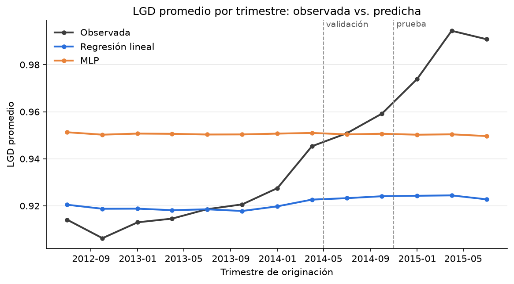

*Fuente:* elaboración propia, `notebooks/regresion.ipynb` (celda 29).

Ningún modelo reproduce la distribución observada (Figura 15). En prueba, el 86 % de los créditos tiene LGD $= 1$ exacta. Las predicciones se concentran en un rango estrecho: entre 0.90 y 0.95 la lineal y entre 0.93 y 0.96 la red. Sus desviaciones estándar son 0.018 y 0.010, frente a 0.076 de la observada. Es lo esperable de un estimador de la media condicional cuando las variables explican poco.

**Figura 15.** *Distribución acumulada de la LGD en prueba: observada y predicha.*

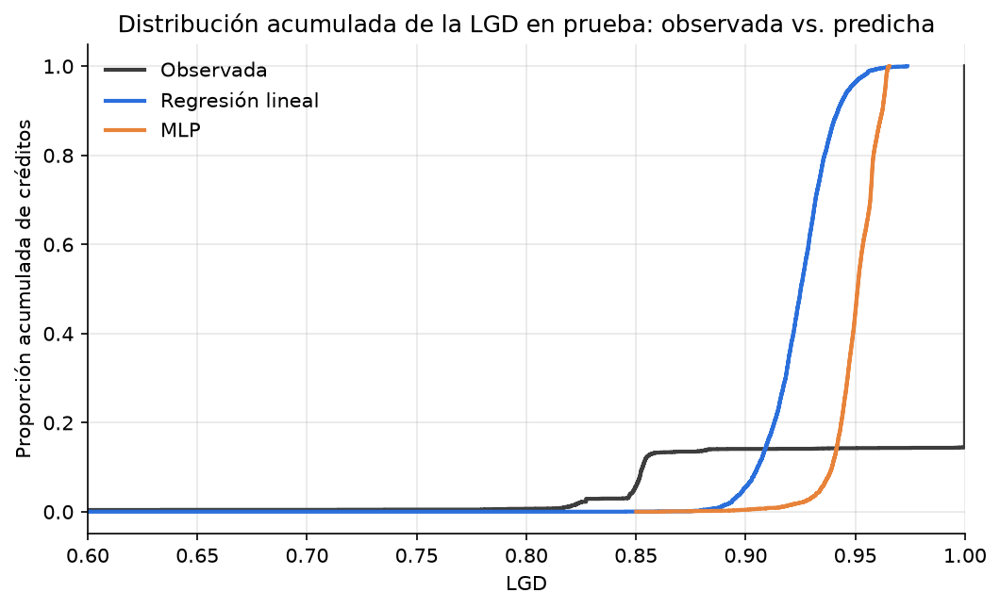

*Fuente:* elaboración propia, `notebooks/regresion.ipynb` (celda 31).

**Conclusión preliminar.** Con variables de originación, la LGD casi no se puede predecir a nivel individual: la correlación de Spearman va de 0.12 a 0.19. Lo que un modelo gana en MAE o RMSE en prueba se debe sobre todo a acertar el nivel de una LGD inflada por el recobro incompleto, no a distinguir entre clientes.

**[PENDIENTE: decidir cómo tratar el recobro incompleto. Opciones de `docs/parte2_lgd.md`: (a) mantener la partición y reportar el sesgo; (b) usar solo cosechas con recobro maduro; (c) seleccionar hiperparámetros con una métrica sin sesgo, como el RMSE sin sesgo o Spearman.]**

### 4.9 Exposición al incumplimiento y pérdida esperada

Al originar no se sabe cuándo incumplirá el cliente. Por eso la EAD se estima como el monto del crédito por la fracción que en promedio queda pendiente al castigo, según el plazo. Esa fracción se calcula con los castigados de entrenamiento:

$$
\widehat{EAD}_i = \text{loan\_amnt}_i \cdot \bar{f}_{\text{plazo}(i)}, \qquad \bar{f}_{36} = 0.670, \qquad \bar{f}_{60} = 0.846.
$$

Se usa `loan_amnt` porque es la variable que conserva el modelo y la que el usuario ingresa en la aplicación. Los créditos a 60 meses amortizan más despacio, así que al incumplir deben una fracción mayor.

Como prueba de coherencia, en el conjunto de prueba todos los créditos incumplieron, así que se usa $PD = 1$. La pérdida observada suma 50,758,058 USD (13,998 por crédito) y la estimada con la red y $\widehat{EAD}$, 40,612,518 USD (11,200 por crédito). La subestimación de 20 % se explica por la LGD de prueba inflada y por usar un factor de EAD promedio.

**Pérdida esperada con la PD de la Parte 1.** `python scripts/perdida_esperada.py` combina la red base de la Parte 1 (con la corrección del peso de clase), la red de LGD y la $\widehat{EAD}$ en los 36,378 créditos de prueba (Tabla 19).

**Tabla 19.** *Pérdida esperada en el conjunto de prueba.*

| Concepto | Valor |
|---|---|
| Créditos | 36,378 |
| Monto prestado | 537.8 millones de USD |
| PD media predicha / tasa observada | 23.7 % / 25.2 % |
| LGD media predicha | 95.1 % |
| EAD media estimada | 11,040 USD |
| **Pérdida esperada total** | **100.5 millones de USD (18.7 % del monto)** |
| Pérdida observada en los castigados | 50.8 millones de USD (3,626 créditos) |
| Incumplidos cuya pérdida aún no se observa (Default o Late) | 5,549 créditos, con 88.0 millones de USD de monto |

*Fuente:* elaboración propia, `python scripts/perdida_esperada.py` (`resultados/perdida_esperada/resumen_red.json`).

La pérdida observada es una cota inferior, porque falta la de 5,549 créditos en `Default` o `Late (31-120 days)` cuyo recobro no ha terminado. Por decil de PD (Figura 16), la pérdida esperada sube de 438 a 7,399 USD por crédito y ordena igual que la observada, que va de 230 a 4,840 USD sin contar esos créditos.

**Figura 16.** *Pérdida esperada y observada por decil de probabilidad de incumplimiento en prueba.*

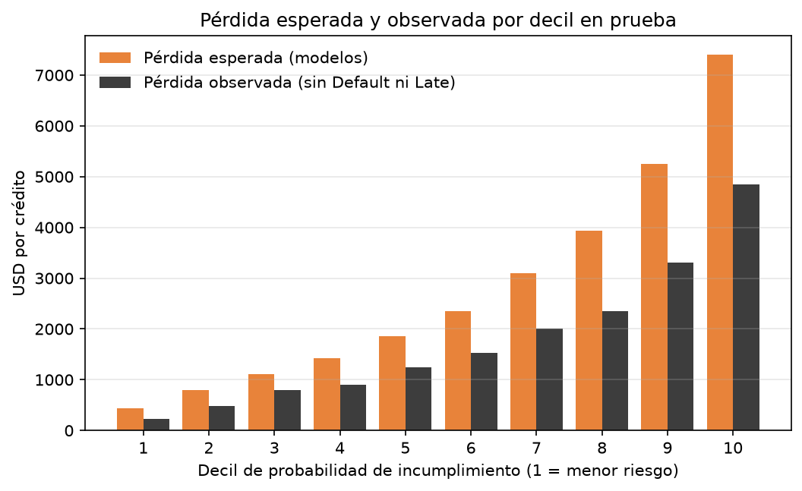

*Fuente:* elaboración propia, `python scripts/perdida_esperada.py`.

---

## 5. Comparación justa

Todos los modelos de una misma tarea usan el mismo preprocesamiento (`src/preprocesamiento.py`) y la misma partición. La Tabla 20 resume el presupuesto de cada familia. Los tiempos son en CPU (Apple M1). Los de la Parte 1 se midieron mientras corrían otros procesos, así que son aproximados.

**Tabla 20.** *Presupuesto de búsqueda, cómputo y complejidad.*

| Tarea | Modelo | Parámetros | Configuraciones | Tiempo de búsqueda | Tiempo de 30 semillas | Métrica en prueba |
|---|---|---|---|---|---|---|
| PD | Regresión logística | 83 | 1 | 0.3 s | — (determinista) | AUC = 0.7033 |
| PD | Red base (final) | 8,161 | 1 (fijada a mano) | — | 7.9 min | AUC = 0.7031 ± 0.0011 |
| PD | Red de la búsqueda | 2,753 | 31 | 9.6 min | 7.6 min | AUC = 0.7043 ± 0.0007 |
| LGD | Media de entrenamiento | 1 | 1 | 0 s | — | RMSE = 0.0950 |
| LGD | Regresión lineal | 83 | 1 | 0.08 s | — (determinista) | RMSE = 0.0926 |
| LGD | Red neuronal | 8,161 | 30 | 6.0 min | 11.8 min | RMSE = 0.0805 ± 0.0007 |

*Fuente:* elaboración propia, `python scripts/parte1_busqueda.py`, `python scripts/parte1_evaluacion.py` y `notebooks/regresion.ipynb` (celdas 22 y 27). En las redes, la métrica es la media ± desviación estándar de 30 semillas.

---

## 6. Discusión

### 6.1 ¿Qué aportó la red neuronal?

**En la probabilidad de incumplimiento, nada medible.**

- **Métricas.** La regresión logística tiene un AUC en prueba de 0.7033. La red base promedia 0.7031 y la de la búsqueda, 0.7043, con desviaciones de 0.0011 y 0.0007 entre semillas. Es decir, la logística queda dentro del rango de las semillas de las dos redes (Tabla 7). La logística tiene mejor KS (0.3057 frente a 0.3004 y 0.3043 en promedio) y las redes, un Brier ligeramente menor (0.1713 frente a 0.1722).
- **Costo.** Para ganar, como mucho, una milésima de AUC hubo que entrenar 91 redes, durante unos 25 minutos, frente a 0.3 s de la logística. Además, cada red tiene entre 33 y 98 veces más parámetros.
- **Interpretabilidad.** La logística da una scorecard continua exacta, con puntos fijos por unidad de cada variable (Tabla 10). La red necesita un método de atribución aproximado, que depende de la línea base que se escoja (Sección 3.7).

Una explicación probable es que la mayor parte de la señal está en `int_rate` y `sub_grade` (Tabla 11). Estas variables ya resumen la evaluación de riesgo de la plataforma, y su relación con el incumplimiento es casi monótona (Figura 3). Sobre esa base no quedan interacciones fuertes que una red pueda aprovechar. Es coherente con que la mejor configuración de la búsqueda haya sido la más pequeña.

**En la LGD, la red gana en error, pero no por entender mejor al cliente.** Su RMSE en prueba es menor (0.0805 frente a 0.0926), pero sin el sesgo de nivel empata con la regresión lineal, y la lineal ordena mejor a los clientes (Sección 4.8). Con variables de originación, la LGD individual es casi impredecible.

### 6.2 Hipótesis

H1 (`dti`), H2 (`int_rate` y `sub_grade`) y H3 (plazo) se confirmaron, tanto en el análisis descriptivo (Tabla 3) como en la importancia de las variables de los modelos (Tabla 11). H4 (antigüedad laboral) no se confirmó: la tasa de incumplimiento es casi igual para todas las antigüedades.

### 6.3 Aprendizajes sobre el problema

1. **Calibrar importa más que la arquitectura.** Sin corregir el efecto del peso de clase, la logística tenía un Brier de 0.2209, peor que el de predecir siempre el promedio (0.1886); con la corrección baja a 0.1722 (Tabla 5). En cambio, entre las 31 arquitecturas de la búsqueda el AUC de validación solo varió entre 0.7072 y 0.7148.
2. **El conjunto de prueba está seleccionado por el tiempo.** Al excluir los créditos vigentes, en las cosechas recientes solo quedan los que terminaron pronto (Figura 4). La tasa de incumplimiento y la LGD observadas dependen de la madurez de la cosecha, no solo del cliente. Una partición aleatoria habría escondido este problema.
3. **En LGD, ganar en RMSE no es lo mismo que entender al cliente.** La red gana porque acierta mejor el nivel de una LGD inflada por el recobro incompleto (Sección 4.8).
4. **Las variables correlacionadas confunden la interpretación.** `sub_grade` sale con signo negativo en la logística y casi sin importancia, solo porque `int_rate` lleva la misma información (Sección 3.7). Por eso hay que medir su importancia juntas.
5. **Una red más grande no fue mejor.** La búsqueda escogió una capa de 32 neuronas sobre la arquitectura base de tres capas, con un tercio de los parámetros y menos variabilidad entre semillas.
6. **Hay que probar el código con un solo caso, no solo con todos los datos.** La función de codificación funcionaba con todo el conjunto, pero con un solo solicitante la opción `drop_first` eliminaba la categoría elegida. Lo descubrimos al construir la aplicación: cambiar el plazo no movía el puntaje.

---

## 7. Fundamentación matemática

### 7.1 Neurona artificial y perceptrón multicapa

Una neurona artificial recibe un vector $\mathbf{x} \in \mathbb{R}^d$, calcula una combinación afín y le aplica una función de activación $\phi$:

$$
z = \mathbf{w}^\top \mathbf{x} + b, \qquad a = \phi(z).
$$

Un perceptrón multicapa encadena capas de neuronas. En nuestras redes, cada capa oculta $l = 1, \dots, L$ aplica una transformación lineal, normalización por lotes (BN, Sección 7.6), la activación y *dropout*:

$$
\mathbf{h}^{(0)} = \mathbf{x}, \qquad
\mathbf{z}^{(l)} = \mathbf{W}^{(l)}\mathbf{h}^{(l-1)} + \mathbf{b}^{(l)}, \qquad
\mathbf{h}^{(l)} = \operatorname{Dropout}\!\left(\phi\!\left(\operatorname{BN}(\mathbf{z}^{(l)})\right)\right).
$$

La salida es un logit, $f_\theta(\mathbf{x}) = \mathbf{w}_{\text{sal}}^\top \mathbf{h}^{(L)} + b_{\text{sal}}$, y la predicción es $\hat{p} = \sigma(f_\theta(\mathbf{x}))$.

Una capa de $d_{\text{in}}$ a $d_{\text{out}}$ neuronas tiene $d_{\text{in}} d_{\text{out}} + d_{\text{out}}$ parámetros lineales y $2d_{\text{out}}$ de la BN ($\gamma$ y $\beta$). Para $82 \to 64 \to 32 \to 16 \to 1$ eso da $5{,}440 + 2{,}144 + 560 + 17 = 8{,}161$, que coincide con lo que reporta PyTorch.

### 7.2 Funciones de activación

**ReLU:** $\phi(z) = \max(0, z)$, con $\phi'(z) = 1$ si $z > 0$ y $0$ si $z < 0$.

**Leaky ReLU:** $\phi(z) = z$ si $z \ge 0$ y $\alpha z$ si $z < 0$, con $\alpha = 0.01$, el valor por defecto de PyTorch. Su derivada es $1$ o $\alpha$.

**Tangente hiperbólica:** $\phi(z) = \tanh z = \dfrac{e^{z} - e^{-z}}{e^{z} + e^{-z}}$, con $\phi'(z) = 1 - \tanh^2 z$. Su salida está en $(-1, 1)$.

**Sigmoide**, en la capa de salida de ambas redes: $\sigma(z) = \dfrac{1}{1 + e^{-z}}$, con $\sigma'(z) = \sigma(z)\,(1 - \sigma(z))$. Lleva $\mathbb{R}$ a $(0, 1)$, que es el rango de una probabilidad y de la LGD.

### 7.3 Funciones de pérdida por máxima verosimilitud

**Entropía cruzada binaria (Parte 1).** Suponemos que, dado $\mathbf{x}_i$, la variable $Y_i \in \{0, 1\}$ es Bernoulli con parámetro $p_i = \sigma(f_\theta(\mathbf{x}_i))$, y que las observaciones son independientes. La verosimilitud y su logaritmo son

$$
\mathcal{L}(\theta) = \prod_{i=1}^{N} p_i^{\,y_i}(1 - p_i)^{1 - y_i}, \qquad
\ln \mathcal{L}(\theta) = \sum_{i=1}^{N}\left[y_i \ln p_i + (1 - y_i)\ln(1 - p_i)\right].
$$

Maximizar la verosimilitud equivale a minimizar el promedio de su negativo:

$$
\ell_{\text{BCE}}(\theta) = -\frac{1}{N}\sum_{i=1}^{N}\left[y_i \ln p_i + (1 - y_i)\ln(1 - p_i)\right].
$$

**Versión ponderada y corrección de las probabilidades.** Con `pos_weight` $= w$, la pérdida de cada crédito es $-\left[w\,y\ln p + (1 - y)\ln(1 - p)\right]$. Fijemos $\mathbf{x}$ y llamemos $\pi = P(Y = 1 \mid \mathbf{x})$. La pérdida esperada de predecir $q$ es

$$
R(q) = -\left[w\,\pi \ln q + (1 - \pi)\ln(1 - q)\right], \qquad
R'(q) = -\frac{w\pi}{q} + \frac{1 - \pi}{1 - q} = 0
\;\Longrightarrow\;
q^* = \frac{w\pi}{w\pi + 1 - \pi}.
$$

En escala logit, $\ln\dfrac{q^*}{1 - q^*} = \ln w + \ln\dfrac{\pi}{1 - \pi}$. Es decir, el peso desplaza el logit en $\ln w$. Para recuperar la probabilidad se resta ese desplazamiento:

$$
\pi = \sigma\!\left(f_\theta(\mathbf{x}) - \ln w\right).
$$

Con $w = 3.61$, el desplazamiento es $\ln 3.61 = 1.28$. La corrección es exacta solo si la red alcanza el mínimo de la pérdida esperada; por eso se verifica con la curva de calibración (Figura 5).

**Entropía cruzada con objetivo continuo (Parte 2).** Para $y_i \in [0, 1]$ se usa la misma expresión, ahora como cuasi-verosimilitud de Bernoulli, con $\mu_i = \sigma(f_\theta(\mathbf{x}_i))$ (Papke y Wooldridge, 1996). Si $m = E[Y \mid \mathbf{x}]$, la pérdida esperada es $-\left[m\ln\mu + (1 - m)\ln(1 - \mu)\right]$, que se minimiza en $\mu = m$. Por tanto estima la media condicional aunque $y$ no sea binaria.

**Error cuadrático medio (Parte 2).** Suponemos $y_i = \mu_\theta(\mathbf{x}_i) + \varepsilon_i$ con $\varepsilon_i \sim \mathcal{N}(0, \sigma^2)$ independientes, donde $\mu_\theta = \sigma(f_\theta)$. La log-verosimilitud es

$$
\ln \mathcal{L}(\theta, \sigma^2) = -\frac{N}{2}\ln(2\pi\sigma^2) - \frac{1}{2\sigma^2}\sum_{i=1}^{N}\left(y_i - \mu_\theta(\mathbf{x}_i)\right)^2.
$$

Con $\sigma^2$ fijo, maximizarla en $\theta$ equivale a minimizar $\ell_{\text{MSE}}(\theta) = \frac{1}{N}\sum_i \left(y_i - \mu_\theta(\mathbf{x}_i)\right)^2$. La LGD no es gaussiana: está acotada y tiene mucha masa en 1. Aun así, $E[(Y - \mu)^2 \mid \mathbf{x}]$ se minimiza en $\mu = E[Y \mid \mathbf{x}]$, que es la cantidad que necesita $E[L]$.

### 7.4 Retropropagación

La retropropagación (Rumelhart et al., 1986) aplica la regla de la cadena desde la salida hacia la entrada. Sea $\delta^{(l)} = \partial \ell / \partial \mathbf{z}^{(l)}$. En la salida, con $z = f_\theta(\mathbf{x})$:

- **Entropía cruzada ponderada:** $\dfrac{\partial \ell}{\partial z} = (1 - y)\,\sigma(z) - w\,y\,(1 - \sigma(z))$. Con $w = 1$ queda $\sigma(z) - y$.
- **Error cuadrático sobre la sigmoide:** $\dfrac{\partial \ell}{\partial z} = 2\,(\sigma(z) - y)\,\sigma(z)\,(1 - \sigma(z))$.

En las capas ocultas, sin contar BN ni *dropout*:

$$
\delta^{(l)} = \left(\mathbf{W}^{(l+1)\top}\delta^{(l+1)}\right) \odot \phi'\!\left(\mathbf{z}^{(l)}\right), \qquad
\frac{\partial \ell}{\partial \mathbf{W}^{(l)}} = \delta^{(l)}\,\mathbf{h}^{(l-1)\top}, \qquad
\frac{\partial \ell}{\partial \mathbf{b}^{(l)}} = \delta^{(l)}.
$$

En un lote se promedian los gradientes de sus créditos. El *dropout* multiplica $\delta$ por la misma máscara de la propagación hacia adelante. Con BN, la regla de la cadena atraviesa también la normalización (Ioffe y Szegedy, 2015); PyTorch la calcula por diferenciación automática.

### 7.5 Optimizador Adam

Sea $\mathbf{g}_t$ el gradiente del lote en el paso $t$. En `torch.optim.Adam`, el `weight_decay` $\lambda$ se suma al gradiente antes de actualizar los momentos (Kingma y Ba, 2015):

$$
\mathbf{g}_t \leftarrow \nabla_\theta \ell(\theta_t) + \lambda\theta_t, \qquad
\mathbf{m}_t = \beta_1\mathbf{m}_{t-1} + (1 - \beta_1)\mathbf{g}_t, \qquad
\mathbf{v}_t = \beta_2\mathbf{v}_{t-1} + (1 - \beta_2)\,\mathbf{g}_t \odot \mathbf{g}_t,
$$

$$
\hat{\mathbf{m}}_t = \frac{\mathbf{m}_t}{1 - \beta_1^t}, \qquad
\hat{\mathbf{v}}_t = \frac{\mathbf{v}_t}{1 - \beta_2^t}, \qquad
\theta_{t+1} = \theta_t - \eta\,\frac{\hat{\mathbf{m}}_t}{\sqrt{\hat{\mathbf{v}}_t} + \epsilon},
$$

con $\beta_1 = 0.9$, $\beta_2 = 0.999$ y $\epsilon = 10^{-8}$, los valores por defecto. Dos detalles:

1. El término $\lambda\theta_t$ pasa por la escala adaptativa de Adam. Por eso no equivale a multiplicar los pesos por $(1 - \eta\lambda)$ en cada paso, como en descenso por gradiente simple; esa es la variante con decaimiento desacoplado (Loshchilov y Hutter, 2019).
2. Se aplica a todos los parámetros, incluidos los sesgos y los de la BN.

Además, `ReduceLROnPlateau` hace $\eta \leftarrow 0.5\,\eta$ cuando la métrica de validación no mejora en 3 épocas.

### 7.6 Regularización y normalización

**Penalización $L_2$.** $J(\theta) = \ell(\theta) + \frac{\lambda}{2}\lVert\theta\rVert_2^2$, cuyo gradiente es $\nabla\ell(\theta) + \lambda\theta$. Es exactamente el término que agrega `weight_decay` (Sección 7.5) y castiga los pesos grandes.

**Dropout** (Srivastava et al., 2014). En entrenamiento, cada activación se apaga con probabilidad $q$ y las que quedan se reescalan:

$$
r_j \sim \text{Bernoulli}(1 - q), \qquad \tilde{h}_j = \frac{r_j\,h_j}{1 - q}, \qquad E[\tilde{h}_j] = h_j.
$$

En evaluación no se apaga nada, y gracias al reescalamiento no hay que corregir los pesos.

**Parada temprana.** Al final de cada época se mide la validación: el AUC en la Parte 1 y la pérdida en la Parte 2. Se guardan los pesos de la mejor época $e^*$ y el entrenamiento se detiene cuando pasan 10 épocas sin mejorar, es decir, cuando $e - e^* \ge 10$. Al final se restauran los pesos de $e^*$.

**Normalización por lotes** (Ioffe y Szegedy, 2015). Para cada neurona, con la media $\mu_B$ y la varianza $\sigma_B^2$ del lote:

$$
\hat{z} = \frac{z - \mu_B}{\sqrt{\sigma_B^2 + \epsilon}}, \qquad \operatorname{BN}(z) = \gamma\,\hat{z} + \beta.
$$

En evaluación se usan promedios móviles de $\mu_B$ y $\sigma_B^2$ calculados en entrenamiento (con *momentum* 0.1 en PyTorch). Hay una consecuencia en nuestra arquitectura: como la BN resta la media, el sesgo $\mathbf{b}^{(l)}$ de la capa lineal anterior no tiene efecto, y su gradiente es cero. Son 112 de los 8,161 parámetros.

### 7.7 Métricas de evaluación

**AUC.** La curva ROC grafica $TPR(t) = P(\hat{p} > t \mid Y = 1)$ contra $FPR(t) = P(\hat{p} > t \mid Y = 0)$ para todos los umbrales $t$. El área bajo ella es la probabilidad de que un mal pagador escogido al azar reciba una probabilidad mayor que un buen pagador escogido al azar (Hanley y McNeil, 1982).

**Índice de Gini.** $\text{Gini} = 2\,AUC - 1$, que vale 0 para un modelo al azar y 1 para uno perfecto.

**Estadístico KS.** Es la máxima distancia entre las distribuciones acumuladas de la probabilidad predicha en malos ($F_1$) y buenos ($F_0$): $KS = \sup_s \lvert F_1(s) - F_0(s)\rvert$. Se calcula con `scipy.stats.ks_2samp` sobre las probabilidades de cada grupo.

**Puntaje de Brier** (Brier, 1950). $BS = \frac{1}{N}\sum_i (\hat{p}_i - y_i)^2$. Como referencia se usa el de predecir siempre la tasa observada $\bar{y}$: $BS_{\text{ref}} = \bar{y}\,(1 - \bar{y})$.

**Curva de calibración.** Los créditos se agrupan en 10 grupos por cuantiles de $\hat{p}$. En cada grupo se compara la probabilidad media predicha con la tasa observada de incumplimiento. Si el modelo está bien calibrado, los puntos caen sobre la diagonal.

**MAE y RMSE.** $MAE = \frac{1}{N}\sum_i \lvert y_i - \hat{y}_i\rvert$ y $RMSE = \sqrt{\frac{1}{N}\sum_i (y_i - \hat{y}_i)^2}$.

**Diagnóstico de la Parte 2.** El sesgo es $\bar{\hat{y}} - \bar{y}$. El RMSE sin sesgo es $\sqrt{\frac{1}{N}\sum_i \left[(y_i - \bar{y}) - (\hat{y}_i - \bar{\hat{y}})\right]^2}$. La correlación de Spearman es la correlación de Pearson entre los rangos de $y$ y de $\hat{y}$.

### 7.8 Derivación de la scorecard

Las odds de ser buen pagador son $\text{Odds} = \dfrac{1 - p}{p}$, y el puntaje es una función afín de su logaritmo (Siddiqi, 2006):

$$
\text{Puntaje} = \text{Offset} + \text{Factor}\cdot\ln(\text{Odds}).
$$

Se imponen dos condiciones. La primera es que, con las odds de referencia, el puntaje sea el puntaje base. La segunda es que, al duplicar las odds, el puntaje suba PDO puntos:

$$
\text{Puntaje}_0 = \text{Offset} + \text{Factor}\cdot\ln(\text{Odds}_0), \qquad
\text{Puntaje}_0 + \text{PDO} = \text{Offset} + \text{Factor}\cdot\ln(2\,\text{Odds}_0).
$$

Restando la primera de la segunda: $\text{PDO} = \text{Factor}\cdot\ln 2$. De ahí salen

$$
\text{Factor} = \frac{\text{PDO}}{\ln 2}, \qquad \text{Offset} = \text{Puntaje}_0 - \text{Factor}\cdot\ln(\text{Odds}_0).
$$

Como $\ln(\text{Odds}) = -\ln\frac{p}{1-p}$ y el logit corregido del modelo es $f_\theta(\mathbf{x}) - \ln w$ (Sección 7.3), el puntaje de un cliente es

$$
\text{Puntaje}(\mathbf{x}) = \text{Offset} - \text{Factor}\cdot\left[f_\theta(\mathbf{x}) - \ln w\right].
$$

A mayor probabilidad de incumplimiento, menor puntaje.

### 7.9 Interpretabilidad

**Importancia por permutación** (Breiman, 2001; Fisher et al., 2019). Sea $G$ un grupo de columnas y $\mathbf{X}^{\pi_G}$ la matriz de prueba con las filas de esas columnas permutadas al azar (la misma permutación para todo el grupo). La importancia del grupo es la caída del AUC, promediada en $R = 5$ permutaciones:

$$
I_G = AUC(\mathbf{X}) - \frac{1}{R}\sum_{r=1}^{R} AUC\!\left(\mathbf{X}^{\pi_G^{(r)}}\right).
$$

**Gradientes integrados** (Sundararajan et al., 2017). Para un crédito $\mathbf{x}$ y una línea base $\mathbf{x}_0$, la atribución de la variable $j$ al logit $f$ es

$$
IG_j(\mathbf{x}) = (x_j - x_{0j})\int_0^1 \frac{\partial f\big(\mathbf{x}_0 + \alpha(\mathbf{x} - \mathbf{x}_0)\big)}{\partial x_j}\,d\alpha
\;\approx\; (x_j - x_{0j})\,\frac{1}{m}\sum_{k=1}^{m}\frac{\partial f\big(\mathbf{x}_0 + \tfrac{k - 1/2}{m}(\mathbf{x} - \mathbf{x}_0)\big)}{\partial x_j},
$$

con $m = 256$ pasos (regla del punto medio). Por el teorema fundamental del cálculo para integrales de línea, $\sum_j IG_j(\mathbf{x}) = f(\mathbf{x}) - f(\mathbf{x}_0)$ (completitud). Con $\mathbf{x}_0 = \mathbf{0}$ en las variables estandarizadas, los puntos de la variable $j$ en la scorecard son $-\text{Factor}\cdot IG_j(\mathbf{x})$, y el puntaje es el de la línea base más la suma de esos puntos (Sección 3.6).

---

## 8. Uso de inteligencia artificial

**[PENDIENTE: se completa según lo que defina el equipo.]**

## 9. Cacería de la alucinación

**[PENDIENTE: se completa según lo que defina el equipo. En el Trabajo 1 cada integrante documentó sus propios hallazgos en un archivo y el blog los resumía en una tabla.]**

---

## Referencias

<!-- [PENDIENTE] Verificar cada referencia (autores, año, páginas y DOI) antes de publicar, como en el Trabajo 1. En particular, confirmar el año y la editorial de Siddiqi. Agregar aquí las que se citen en las secciones que faltan. -->

Bergstra, J., & Bengio, Y. (2012). Random search for hyper-parameter optimization. *Journal of Machine Learning Research, 13*, 281–305. https://jmlr.org/papers/v13/bergstra12a.html

Breiman, L. (2001). Random forests. *Machine Learning, 45*(1), 5–32. https://doi.org/10.1023/A:1010933404324

Brier, G. W. (1950). Verification of forecasts expressed in terms of probability. *Monthly Weather Review, 78*(1), 1–3. https://doi.org/10.1175/1520-0493(1950)078<0001:VOFEIT>2.0.CO;2

Fisher, A., Rudin, C., & Dominici, F. (2019). All models are wrong, but many are useful: Learning a variable's importance by studying an entire class of prediction models simultaneously. *Journal of Machine Learning Research, 20*(177), 1–81. https://jmlr.org/papers/v20/18-760.html

Hanley, J. A., & McNeil, B. J. (1982). The meaning and use of the area under a receiver operating characteristic (ROC) curve. *Radiology, 143*(1), 29–36. https://doi.org/10.1148/radiology.143.1.7063747

Ioffe, S., & Szegedy, C. (2015). Batch normalization: Accelerating deep network training by reducing internal covariate shift. En *Proceedings of the 32nd International Conference on Machine Learning* (Vol. 37, pp. 448–456). PMLR. https://proceedings.mlr.press/v37/ioffe15.html

Kingma, D. P., & Ba, J. (2015). Adam: A method for stochastic optimization. En *3rd International Conference on Learning Representations (ICLR 2015)*. https://arxiv.org/abs/1412.6980

Loshchilov, I., & Hutter, F. (2019). Decoupled weight decay regularization. En *7th International Conference on Learning Representations (ICLR 2019)*. https://arxiv.org/abs/1711.05101

Papke, L. E., & Wooldridge, J. M. (1996). Econometric methods for fractional response variables with an application to 401(k) plan participation rates. *Journal of Applied Econometrics, 11*(6), 619–632. https://doi.org/10.1002/(SICI)1099-1255(199611)11:6<619::AID-JAE418>3.0.CO;2-1

ranadeep. (s. f.). *Credit risk analysis* [Conjunto de datos]. Kaggle. Recuperado el **[PENDIENTE: fecha de descarga]** de https://www.kaggle.com/datasets/ranadeep/credit-risk-dataset

Rumelhart, D. E., Hinton, G. E., & Williams, R. J. (1986). Learning representations by back-propagating errors. *Nature, 323*(6088), 533–536. https://doi.org/10.1038/323533a0

Siddiqi, N. (2006). *Credit risk scorecards: Developing and implementing intelligent credit scoring*. John Wiley & Sons.

Srivastava, N., Hinton, G., Krizhevsky, A., Sutskever, I., & Salakhutdinov, R. (2014). Dropout: A simple way to prevent neural networks from overfitting. *Journal of Machine Learning Research, 15*(56), 1929–1958. https://jmlr.org/papers/v15/srivastava14a.html

Sundararajan, M., Taly, A., & Yan, Q. (2017). Axiomatic attribution for deep networks. En *Proceedings of the 34th International Conference on Machine Learning* (Vol. 70, pp. 3319–3328). PMLR. https://proceedings.mlr.press/v70/sundararajan17a.html
